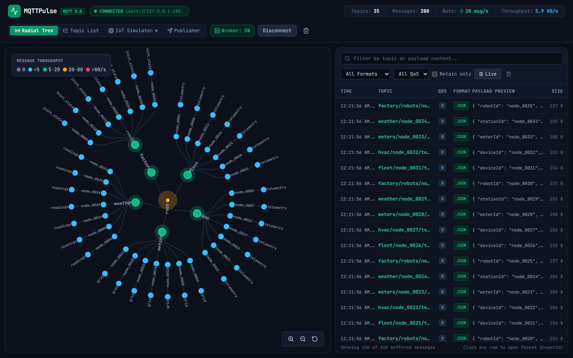
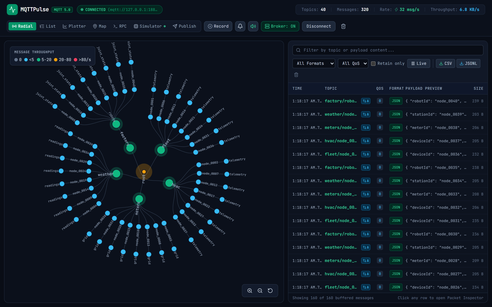
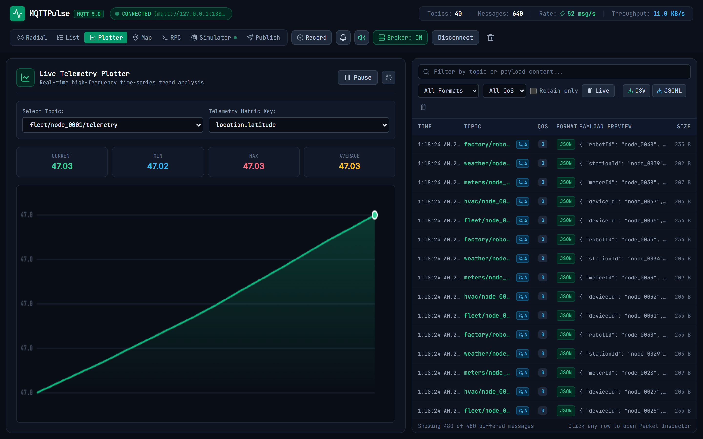
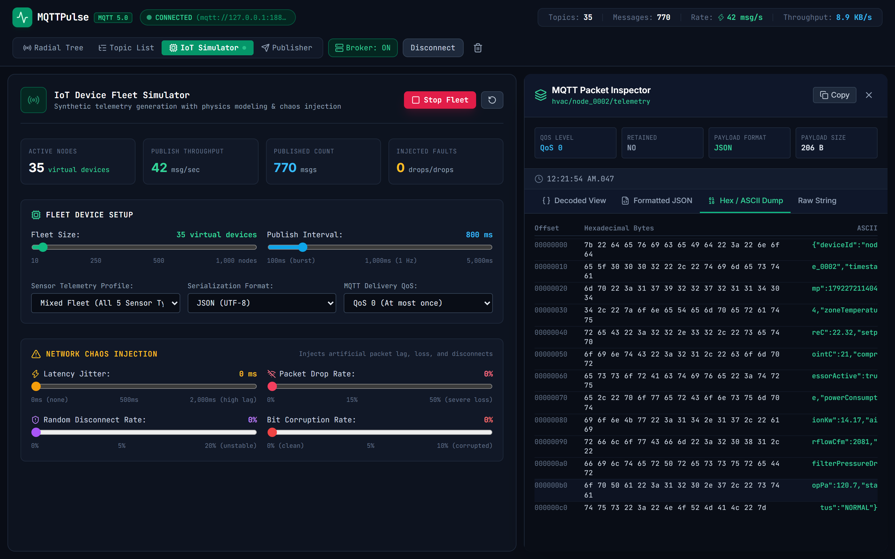
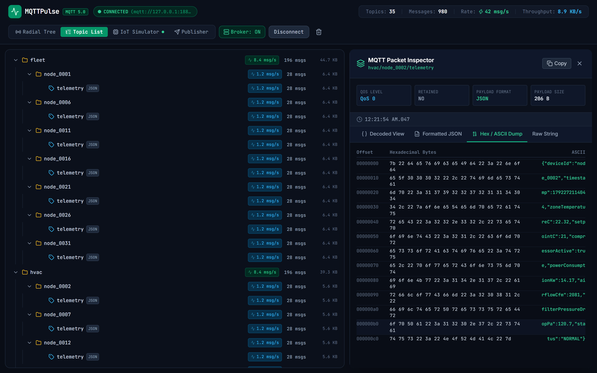

<div align="center">


# MQTTPulse

**Real-time MQTT 5.0 and 3.1.1 topic tree visualizer, payload decoder, and IoT device fleet chaos simulator.**

[](LICENSE)
[](https://nodejs.org)
[](https://www.typescriptlang.org)
[](https://react.dev)
[](https://d3js.org)

<br />



</div>

## Overview

MQTT powers connected device architectures, industrial telemetry, robotics, and smart home systems. Developing and auditing these systems often hits specific tooling limits:
1. Topic hierarchies with single-level (`+`) and multi-level (`#`) wildcards hide where messages actually flow and which branches consume bandwidth.
2. Legacy tools ignore MQTT 5.0 protocol fields like User Properties, Reason Codes, Content-Type, and Message Expiry.
3. Telemetry payloads arrive in binary encodings such as Protocol Buffers, CBOR, or MessagePack without in-flight deserialization.
4. Testing broker ingest or subscriber throughput requires either real hardware or bespoke load scripts with mock connections.

MQTTPulse packages these functions into a single binary and web cockpit. It runs an in-memory topic trie that indexes topic namespaces at over 1.4 million messages per second, extracts MQTT 5.0 packet properties, decodes binary payloads on the fly, and simulates fleets of up to 1,000 synthetic IoT devices with physics-based sensor models and configurable network faults.

```
+-----------------------------------------------------------------------------------+
|                                     MQTTPULSE                                     |
+-----------------------------------------+-----------------------------------------+
                                          |
        +---------------------------------+---------------------------------+
        |                                                                   |
+-------v-------------------------+                 +-----------------------v-------+
|     Broker Connection Engine    |                 |     Topic Tree Trie Engine    |
|  * MQTT 5.0 and 3.1.1 transport |                 |  * Real-Time Namespace Trie   |
|  * TCP, TLS, and WebSockets     |                 |  * Wildcard Matcher (+, #)    |
|  * Auto-downgrade & reconnect   |                 |  * Moving message rate/sec    |
+-------+-------------------------+                 +-----------------------+-------+
        |                                                                   |
        +---------------------------------+---------------------------------+
                                          |
                        +-----------------v-----------------+
                        |    In-Flight Payload Decoder      |
                        |  * JSON, Protobuf, CBOR, MsgPack  |
                        |  * Hex / ASCII dual column dump   |
                        |  * MQTT 5.0 User Properties       |
                        +-----------------+-----------------+
                                          |
                        +-----------------v-----------------+
                        |   IoT Fleet & Chaos Simulator     |
                        |  * Up to 1,000 virtual sensors    |
                        |  * 5 physical sensor profiles     |
                        |  * Jitter, drops, and disconnects |
                        +-----------------+-----------------+
                                          |
                        +-----------------v-----------------+
                        |      Web Studio & Diagnostics     |
                        |  * D3.js Radial & Indented Tree   |
                        |  * Virtualized live message table |
                        |  * Interactive MQTT 5.0 Publisher |
                        +-----------------------------------+
```

---

## User Interface

<div align="center">

### D3.js Radial Topic Tree

<p><em>Circular radial tree visualization with nodes colored by rolling message rate (msgs/sec) and live message telemetry table.</em></p>

### Deep Packet Inspector

<p><em>MQTT 5.0 header metadata inspector with User Properties table and hexadecimal/ASCII byte dump.</em></p>

### IoT Fleet Simulator & Network Chaos Controls

<p><em>Configuration cockpit managing synthetic sensor devices, publication intervals, latency jitter, and packet drop probabilities.</em></p>

### Collapsible Topic Hierarchy List

<p><em>Indented topic tree showing subtree message counts, cumulative byte size, and rolling throughput rates per branch.</em></p>

</div>

---

## Key Capabilities

### 1. In-Memory Topic Trie & Wildcard Indexing
- Built on a tree structure where each segment between slashes (`/`) maps to a node.
- Tracks total message counts, byte volume, rolling 10-second message rates (`msg/s`), and last-seen timestamps.
- Evaluates MQTT single-level (`+`) and multi-level (`#`) wildcards while enforcing system topic (`$SYS/`) isolation.
- Tested to process 50,000 messages in 34ms (1.46 million msgs/sec throughput).

### 2. In-Flight Payload Decoder
- **JSON**: Validates and syntax-highlights nested structured telemetry.
- **Protocol Buffers**: Dynamic schema registry with preloaded definitions for vehicles, smart meters, and sensors, plus support for custom runtime `.proto` schema uploads.
- **CBOR**: Decodes Concise Binary Object Representation payloads.
- **MessagePack**: Decodes binary MessagePack objects directly from buffers.
- **Hex / ASCII Dump**: 16-byte aligned offset view with side-by-side printable ASCII preview.

### 3. MQTT 5.0 Protocol Metadata Inspection
- Extracts key-value **User Properties** attached by publishers.
- Exposes **Content-Type**, **Payload Format Indicator** (0 for raw bytes, 1 for UTF-8), and **Message Expiry Interval**.
- Displays **Response Topic** and **Correlation Data** for request-response flows.
- Tracks delivery latency for QoS 1 (`PUBACK`) and QoS 2 handshakes.

### 4. Virtual IoT Device Simulator with Chaos Engine
- Instantiates 10 to 1,000 virtual sensor nodes publishing concurrently.
- Five physics models based on Ornstein-Uhlenbeck continuous mean-reverting processes and diurnal variation:
  - **Connected Vehicle**: Latitude, longitude, vehicle speed, engine RPM, fuel level, and battery voltage.
  - **Industrial HVAC**: Zone temperature, compressor duty cycle, airflow CFM, and filter pressure drop.
  - **Three-Phase Smart Meter**: Active power, reactive power, voltage, current, power factor, and cumulative kWh.
  - **Weather Station**: Ambient temperature, humidity, barometric pressure, wind speed, wind direction, and PM2.5.
  - **Robotic Arm**: 6-axis joint angles, motor torque, vibration frequencies, and cycle counts.
- Fault injection:
  - Jitter delays from 10ms to 2,000ms.
  - Packet loss probabilities up to 50%.
  - Random socket disconnects and reconnect backoff.
  - Bit-flip payload corruption.

### 5. Embedded In-Memory Broker
- Ships with an embedded Aedes broker listening on port 18883.
- Runs without any external broker installation for instant local testing, offline debugging, and simulation.

### 6. Live Payload Diffing (Time-Travel Delta)
- Computes recursive structural deltas between consecutive packets on the same topic.
- Identifies added, modified, and deleted properties in nested objects and arrays.
- Renders color-coded diff views with path indicators in the Packet Inspector.

### 7. Live Telemetry Plotter (Continuous Time-Series)
- 60 FPS HTML5 Canvas graph tracking numerical telemetry fields in real time.
- Rolling window with min, max, average, and current value callouts.
- Automatic field extraction from incoming JSON and decoded telemetry payloads.

### 8. Schema Drift & Anomaly Detector
- Dynamic fingerprinting of topic telemetry structures.
- Detects type mutations (e.g. number switching to string) and unexpected new fields after baseline stabilization.
- Visual warning badges in the message stream and detailed anomaly diagnostics in the inspector.

### 9. Session Recording & Replay Engine
- Records raw incoming packets with millisecond delta timestamps.
- Exports recorded sessions in standardized JSONL format.
- Replays historical telemetry through the engine at 0.5x, 1x, 2x, or 5x speed for stress testing and regression analysis.

### 10. Fleet Geolocation Map View
- Vector-rendered interactive GPS coordinate tracker for simulated and physical mobile IoT devices.
- Visualizes latitude, longitude, movement heading angles, and velocity (km/h) with status color-coding.

### 11. Bidirectional MQTT 5.0 RPC Console
- Sends command payloads with `responseTopic` and cryptographic `correlationData`.
- Awaits asynchronous responses matching the correlation token and calculates round-trip time in milliseconds.
- Virtual IoT fleet nodes automatically handle commands and emit acknowledge payloads.

### 12. Rule Triggers & Telemetry Alerts Engine
- Evaluates incoming payloads against threshold rules (`>`, `<`, `>=`, `<=`, `==`, `!=`, `contains`).
- Configurable severity levels (info, warning, critical) and cooldown intervals to prevent alert spam.
- In-memory event ledger with read tracking and direct alert dismissal.

### 13. Prometheus Metrics (`/metrics`)
- Standard Prometheus text format export of broker throughput, message counters, active topics, chaos fault injections, and alert statistics.
- Ready for integration with Prometheus, VictoriaMetrics, and Grafana dashboards.

### 14. Web Audio Micro-Interactions
- Procedural Web Audio API synthesizer generating tactile auditory feedback for packet arrivals, publisher dispatches, alerts, and dropped frames.
- Completely self-contained with zero audio asset dependencies and instant mute toggling.

### 15. One-Click Data Export
- Direct in-browser export of filtered message streams to CSV and JSONL formats with timestamp offsets and decoded payload structures.

---

## Quick Start

### Installation

Run directly with Node.js 22+:

```bash
# Clone the repository
git clone https://github.com/alexandrmotologa/mqttpulse.git
cd mqttpulse

# Install dependencies and build
npm install
npm run build
```

### Launching the Studio

Start with the built-in embedded broker and simulator:

```bash
node dist/cli.js --embedded-broker --port 4100 --simulate --fleet-size 50
```

Open your browser at `http://localhost:4100`.

### Connecting to an External Broker

Connect directly to an existing broker over TCP, TLS, or WebSockets:

```bash
# Connect to local Mosquitto
node dist/cli.js --broker mqtt://localhost:1883 --topic "sensors/#"

# Connect to EMQX public sandbox
node dist/cli.js --broker mqtt://broker.emqx.io:1883 --topic "test/+"
```

---

## Command Line Interface

```
Usage: mqttpulse [options]

Real-time MQTT 5.0 and 3.1.1 topic tree visualizer, payload decoder, and IoT fleet simulator

Options:
  -v, --version                Output the current version
  -b, --broker <url>           MQTT broker URL to connect to (e.g. mqtt://localhost:1883)
  -p, --port <number>          Web Studio HTTP port (default: 4100)
  -t, --topic <pattern>        Topic filter to subscribe to on startup (default: "#")
  -e, --embedded-broker        Launch embedded in-memory MQTT broker on port 18883
  -s, --simulate               Automatically start IoT fleet simulator on boot
  -n, --fleet-size <number>    Number of virtual IoT nodes to simulate (default: 50)
  --profile <type>             Sensor profile: fleet_vehicle, hvac_industrial, smart_meter, weather_station, robotics_actuator, mixed
  --format <format>            Serialization format: json, cbor, msgpack, protobuf
  --jitter <ms>                Injected network latency jitter in milliseconds (default: 0)
  --drop <pct>                 Injected packet drop percentage 0-100 (default: 0)
  -h, --help                   Display help text
```

---

## REST & WebSocket API

The Fastify server exposes endpoints for automation and integration:

| Method | Endpoint | Description |
|---|---|---|
| `GET` | `/metrics` | Standard Prometheus metric export (gauges, counters, rate, throughput) |
| `GET` | `/api/status` | Broker connection state, client metrics, embedded broker status, and simulator stats |
| `POST` | `/api/connect` | Connect to an MQTT broker (`url`, `clientId`, `protocolVersion`, `clean`, `topic`) |
| `POST` | `/api/disconnect` | Terminate the current broker connection |
| `POST` | `/api/subscribe` | Subscribe to a topic filter with specified QoS (`topicFilter`, `qos`) |
| `POST` | `/api/unsubscribe` | Remove a topic filter subscription (`topicFilter`) |
| `POST` | `/api/publish` | Publish an MQTT message with payload, QoS, retain flag, and user properties |
| `POST` | `/api/rpc` | Execute MQTT 5.0 request-response RPC with correlation token and response topic |
| `GET` | `/api/tree` | Fetch the complete serialized Topic Trie hierarchy for visualization |
| `GET` | `/api/stats` | Global throughput, message rates, and byte counters |
| `POST` | `/api/tree/clear` | Reset the in-memory topic trie and message buffer |
| `GET` | `/api/messages` | Retrieve recent buffered messages (supports `?limit=100`) |
| `GET` | `/api/timeseries` | Query time-series telemetry series and active numerical field keys |
| `GET` | `/api/geo/markers` | Retrieve live GPS coordinates, headings, and speeds for mobile fleet nodes |
| `GET` | `/api/rules` | List configured telemetry threshold rules |
| `POST` | `/api/rules` | Create a new evaluation rule (`topicFilter`, `field`, `operator`, `value`, `severity`) |
| `DELETE`| `/api/rules/:id` | Remove a telemetry evaluation rule |
| `POST` | `/api/rules/:id/toggle` | Enable or disable a telemetry evaluation rule |
| `GET` | `/api/alerts` | List triggered alert events |
| `POST` | `/api/alerts/read` | Mark all alerts as read |
| `POST` | `/api/alerts/clear` | Clear alert history |
| `POST` | `/api/recording/start` | Start telemetry session recording |
| `POST` | `/api/recording/stop` | Stop recording and retrieve compiled session |
| `GET` | `/api/recording/status` | Current recording state and buffered packet count |
| `GET` | `/api/recording/export` | Download recorded session as JSONL |
| `POST` | `/api/recording/replay` | Replay recorded session through the broker at variable playback speeds |
| `GET` | `/api/simulator` | Fetch current fleet simulator configuration and telemetry statistics |
| `POST` | `/api/simulator/config` | Update fleet size, sensor profile, format, interval, or chaos settings |
| `POST` | `/api/simulator/start` | Start virtual device telemetry emissions |
| `POST` | `/api/simulator/stop` | Pause virtual device emissions |
| `POST` | `/api/simulator/reset` | Reset simulation counters |
| `GET` | `/api/schemas` | List registered Protocol Buffer schemas |
| `POST` | `/api/schemas` | Register a custom `.proto` schema dynamically |
| `POST` | `/api/broker/embedded`| Start or stop the internal embedded Aedes broker |
| `WS` | `/ws` | Real-time duplex streaming for tree updates, incoming messages, and broker telemetry |

---

## Verification & Tests

Run the Vitest test suite covering topic wildcard matching, trie operations, decoders, physics models, embedded broker integration, payload diffing, schema drift, rules engine, and Prometheus metrics:

```bash
npm test
```

Test output:

```
 RUN  v3.2.7 B:/workgit/mqttpulse

 ✓ tests/wildcard.test.ts (6 tests)
 ✓ tests/trie.test.ts (5 tests)
 ✓ tests/benchmark.test.ts (1 test) -> 1,454,829 msgs/sec
 ✓ tests/features.test.ts (9 tests)
 ✓ tests/simulator.test.ts (5 tests)
 ✓ tests/decoders.test.ts (6 tests)
 ✓ tests/broker_client.test.ts (2 tests)

 Test Files  7 passed (7)
      Tests  34 passed (34)
   Duration  1.61s
```

---

## Architecture & Codebase Layout

```
mqttpulse/
├── bin/
│   └── mqttpulse.js            # Executable CLI wrapper
├── docs/
│   └── images/                 # Architecture diagram, vector logo, and UI screenshots
├── scripts/
│   └── capture_assets.js       # Puppeteer and FFmpeg screenshot/GIF generation script
├── src/
│   ├── broker/
│   │   └── embedded.ts         # In-memory Aedes broker wrapper
│   ├── core/
│   │   ├── client.ts           # MQTT 5.0/3.1.1 client connection manager with protocol downgrade
│   │   ├── diff.ts             # Structural payload diffing and change calculator
│   │   ├── recorder.ts         # Telemetry session recorder and variable-speed replayer
│   │   ├── rules.ts            # Threshold evaluation rules and alerts engine
│   │   ├── schema_drift.ts     # Topic schema fingerprinting and drift detector
│   │   ├── stats.ts            # Moving average throughput and message rate calculators
│   │   ├── trie.ts             # In-memory topic hierarchy Trie data structure
│   │   └── wildcard.ts         # MQTT topic filter validation and matching (+, #, $SYS)
│   ├── decoders/
│   │   ├── cbor.ts             # CBOR binary parser
│   │   ├── detector.ts         # In-flight format sniffer (JSON, CBOR, MsgPack, Proto, Hex)
│   │   ├── hex.ts              # Hexadecimal offset and printable ASCII dump formatter
│   │   ├── json.ts             # Fast JSON parser with pretty-printer
│   │   ├── msgpack.ts          # MessagePack decoder
│   │   └── protobuf.ts         # Protobufjs schema loader and dynamic message deserializer
│   ├── server/
│   │   ├── api.ts              # Fastify REST endpoints
│   │   ├── index.ts            # Server factory and static web asset serving
│   │   ├── metrics.ts          # Prometheus metrics generation
│   │   ├── state.ts            # Shared application state
│   │   └── ws.ts               # WebSocket telemetry and message stream broadcaster
│   ├── simulator/
│   │   ├── chaos.ts            # Latency jitter, packet loss, and bit-flip fault injector
│   │   ├── device_profile.ts   # 5 physical sensor profiles with state update rules
│   │   ├── fleet_manager.ts    # Coordinator for up to 1,000 synthetic devices with RPC response
│   │   └── physics.ts          # Ornstein-Uhlenbeck mean-reverting and GPS navigation math
│   └── cli.ts                  # Command line interface definition
├── tests/
│   ├── benchmark.test.ts       # Throughput stress test
│   ├── broker_client.test.ts   # End-to-end integration test
│   ├── decoders.test.ts        # Payload decoders test suite
│   ├── features.test.ts        # Advanced features tests (diff, drift, rules, recording, metrics)
│   ├── simulator.test.ts       # Physics and chaos engine tests
│   ├── trie.test.ts            # Topic tree trie unit tests
│   └── wildcard.test.ts        # MQTT wildcard compliance test suite
├── web/
│   ├── src/
│   │   ├── components/
│   │   │   ├── ConnectModal.tsx        # Broker connection dialog
│   │   │   ├── FleetControls.tsx       # Simulator and chaos injection sliders
│   │   │   ├── FleetMapView.tsx        # GPS vector map view with node headings
│   │   │   ├── Header.tsx              # Top navigation bar and status indicators
│   │   │   ├── LivePlotter.tsx         # Real-time HTML5 Canvas time-series plotter
│   │   │   ├── MessageStreamTable.tsx  # Live virtualized message table with filters and export
│   │   │   ├── PacketInspector.tsx     # MQTT 5.0 properties, payload diffs, and hex dump
│   │   │   ├── PublishTestBench.tsx    # Interactive MQTT message publisher
│   │   │   ├── RpcConsole.tsx          # MQTT 5.0 request-response RPC console
│   │   │   ├── RulesAlertsModal.tsx    # Threshold rules configuration and alert ledger
│   │   │   ├── TopicTreeIndented.tsx   # Collapsible topic hierarchy table
│   │   │   └── TopicTreeRadial.tsx     # D3.js interactive radial topic tree
│   │   ├── hooks/
│   │   │   └── useMqttStream.ts        # Real-time WebSocket hook
│   │   ├── utils/
│   │   │   ├── audio.ts                # Web Audio API micro-interactions synthesizer
│   │   │   └── export.ts               # CSV and JSONL client-side exporters
│   │   ├── App.tsx                     # Main layout
│   │   ├── main.tsx                    # React 19 mount point
│   │   └── types.ts                    # TypeScript interface contracts
│   ├── index.html
│   ├── tailwind.config.js
│   └── vite.config.ts
├── LICENSE
├── package.json
└── tsconfig.json
```

---

## License

MIT License. Copyright (c) 2026 Alexandr Motologa.
